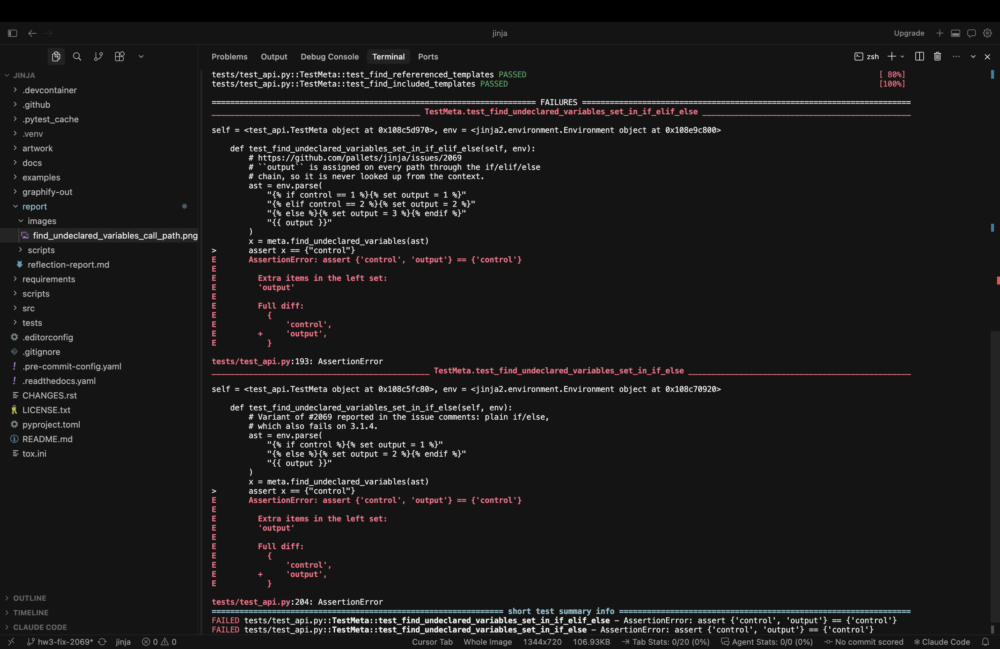

# Homework 3 Reflection Report: Fixing Jinja #2069 with a Coding Agent

Rachit · CS593 ASE · Repository: [rachit-k/CS593ASE_HW3](https://github.com/rachit-k/CS593ASE_HW3) · Branch: `hw3-fix-2069` (from tag `3.1.6`)

**Coding agent:** Claude Code (Claude Opus 5.5), VS Code extension, with the graphify skill for building a repository knowledge graph.

---

## 1. Repository Understanding and Bug Reproduction

### 1.1 The bug

[Issue #2069](https://github.com/pallets/jinja/issues/2069) reports that `jinja2.meta.find_undeclared_variables()` lists a variable as undeclared even though the template assigns it in every branch of an `if` statement:

```jinja



{{ output }}
```

| | Result |
| --- | --- |
| Expected | `{'control'}` |
| Observed (3.1.5, 3.1.6) | `{'control', 'output'}` |

The function's job is to list the variables a caller must supply in the render context. Here `output` is set on every path before it is printed, so it never comes from the context. Reporting it is a false positive.

**Confirming the expected answer.** The issue states the expected value but does not justify it, so the agent checked it by rendering the template with a decoy `output='FROM_CONTEXT'` in the context. For `control` = 1, 2, 3 and 99 the output was `1`, `2`, `3` and `3`, so the decoy was never used. Removing the `else` changes this: `{{ y }}` renders `FROM_CONTEXT` when `x` is false. In that template `y` genuinely is undeclared and must still be reported.

**When it happens.** The issue title blames 3.1.5, but a commenter on the issue reported that `if/else` also fails on 3.1.4. The agent ran the same templates against 3.1.4, 3.1.5 and 3.1.6 (`report/scripts/version_matrix.py`):

| Template shape | Expected | 3.1.4 | 3.1.5 and 3.1.6 |
| --- | --- | --- | --- |
| `if / elif / else`, every branch assigns (the issue) | `control` | correct | adds `output` |
| `if / else`, both branches assign | `x` | adds `y` | adds `y` |
| Nested `if / else`, every path assigns | `a, b` | adds `y` | adds `y` |
| Same, inside a `for` loop or a macro | loop var / none | adds `y` | adds `y` |
| `if` with no `else` | `x, y` | correct | correct |
| `if / elif / else` where one branch skips the assignment | `x, y, z` | correct | correct |

The bug occurs whenever a name is assigned on *every* path through an `if` that has an `else`. It is not specific to `elif`, and 3.1.5 did not introduce it: 3.1.5 only broke the `elif` form, which 3.1.4 happened to get right. When some path leaves the name unassigned, reporting it is correct. A fix must keep those rows correct and cannot simply ignore assignments inside conditionals.

### 1.2 Relevant components

`find_undeclared_variables()` doesn't analyze templates itself. It runs Jinja's real code generator in a mode that writes no code and collects every name the generated code would look up from the context.

- **`meta.py`:** `TrackingCodeGenerator` subclasses `CodeGenerator`. Its `enter_frame()` keeps every symbol whose load action is `resolve` (look it up in the context). That set is the function's result.
- **`compiler.py`:** `CodeGenerator` builds a `Frame` for each scope (template body, `for` loop, macro). For the issue's template, the generated code starts with `l_0_output = resolve('output')`, so the context lookup comes from the compiler's own symbol table, not from a separate mistake in `meta.py`.
- **`idtracking.py`:** `FrameSymbolVisitor.visit_If()` analyzes each branch of an `if` separately, then `Symbols.branch_update()` merges the branches back into the enclosing scope and decides each name's load action. This is where Part 2 starts.

**How the agent found these.** It ran `/graphify` to build a knowledge graph of the repository (about 2,800 nodes), then followed the graph's call and inheritance edges from `find_undeclared_variables` to `branch_update`. It then read only those three files. Along the way it found that the clone was on `main` (164 commits past 3.1.6), not on 3.1.6 as I had told it, and moved the work onto a branch created from the `3.1.6` tag.

### 1.3 Reproduction tests

Two tests were added to the existing `TestMeta` class in `tests/test_api.py`, which already holds the tests for `find_undeclared_variables`. They use the suite's `env` fixture and follow the existing test's style.

| Test | Template | What it checks | Why it is there |
| --- | --- | --- | --- |
| `test_find_undeclared_variables_set_in_if_elif_else` | `if / elif / else` on `control`, each branch sets `output` | The result is exactly `{'control'}` | The scenario reported in the issue |
| `test_find_undeclared_variables_set_in_if_else` | `if control / else`, both branches set `output` | The result is exactly `{'control'}` | A commenter's variant, which shows the bug is not specific to `elif` and also fails on 3.1.4 |

Both tests assert that the result *equals* `{'control'}`, rather than that `'output'` is merely absent. This makes each test check two things: the variable assigned on every path is not reported, and the variable used in the condition is still reported. A "fix" that hid all variables near an `if` would therefore still fail.

The tests that check variables which *must* still be reported (no `else`, a branch that skips the assignment, nested ifs) are not reproduction tests, because they already pass. They are added in Part 3 as regression guards. Three existing tests in `tests/test_idtracking.py` already check that a variable assigned in an `if` with no `else` is looked up from the context.

### 1.4 How to reproduce

The branch was created from the release tag with `git switch -c hw3-fix-2069 3.1.6`. To reproduce from a fresh clone:

```bash
git clone https://github.com/rachit-k/CS593ASE_HW3.git && cd CS593ASE_HW3
git switch hw3-fix-2069          # the branch already exists on the remote
python3.12 -m venv .venv
.venv/bin/pip install -r requirements/tests.txt -e .
.venv/bin/python -m pytest tests/test_api.py::TestMeta -v
```

On 3.1.6 with only the tests added, both new tests fail and everything else passes:

```
tests/test_api.py::TestMeta::test_find_undeclared_variables PASSED
tests/test_api.py::TestMeta::test_find_undeclared_variables_set_in_if_elif_else FAILED
tests/test_api.py::TestMeta::test_find_undeclared_variables_set_in_if_else FAILED
tests/test_api.py::TestMeta::test_find_refererenced_templates PASSED
tests/test_api.py::TestMeta::test_find_included_templates PASSED
E       AssertionError: assert {'control', 'output'} == {'control'}
E         Extra items in the left set:
E         'output'
```

Full suite: **2 failed, 909 passed**. Before the tests were added, the suite was 909 passed.



*Figure 1. The two reproduction tests failing on unmodified Jinja 3.1.6.*

---

## 2. Bug Localization and Root Cause Analysis

### 2.1 Root cause

`meta.py` is not at fault. It correctly reports what the compiler decided. The false positive comes from `Symbols.branch_update()` in `src/jinja2/idtracking.py` (L123–145). This function merges the symbol tables of an `if` statement's branches back into the enclosing scope. In 3.1.6 it marks every name assigned in *any* branch as `resolve` ("look it up in the context"). It never asks whether every path assigns that name before reading it.

```python
def branch_update(self, branch_symbols):          # idtracking.py, 3.1.6
    stores = set()
    for branch in branch_symbols:
        stores.update(branch.stores)              # names assigned in ANY branch
    stores.difference_update(self.stores)         # ...that weren't defined before the if
    for sym in branch_symbols:
        self.refs.update(sym.refs)
        self.loads.update(sym.loads)              # per-branch loads: last branch wins
        self.stores.update(sym.stores)
    for name in stores:                           # every such name ->
        ...                                       #   alias (if an outer scope has it)
        self.loads[target] = (VAR_LOAD_RESOLVE, name)   # or resolve
```

The code generator emits `l_0_output = resolve('output')` for each `resolve` load. `TrackingCodeGenerator.enter_frame()` in `meta.py` collects exactly these names. So `output` is reported even though every branch overwrites it before it is printed. Rendering is unaffected: the lookup is wasted, but the result is correct. That is why the problem only shows up through `find_undeclared_variables()`.

**Why simply restoring the old check does not work.** Jinja 3.1.4 skipped names stored in *all* branches. Commit `66587ce9` ("Fix bug where set would sometimes fail within if", for issue #1253, released in 3.1.5) removed that shortcut. The 3.1.4 rule was wrong in three ways, which explains both the original crash and the inconsistent results in Section 1.1:

1. **Merging is "last branch wins".** Each branch's own symbol table already records the right answer for that branch:
    - `undefined` means the branch assigns the name before reading it.
    - `resolve` means the branch reads it first.

    But `self.loads.update(sym.loads)` lets a later branch overwrite an earlier one. In #1253 the `if` body reads `a` before setting it (`resolve`), and the `else` branch's `undefined` replaced that. Rendering then raised `UndefinedError`. The 3.1.5 fix avoided the overwrite by forcing `resolve` for every conditionally assigned name, which is what created #2069.
2. **An `if` is always analyzed as exactly three branches.** `FrameSymbolVisitor.visit_If()` (L252–268) passes three symbol tables: the body, *all* `elif`s together, and the `else`. Missing ones are passed as empty tables, so a plain `if/else` has an empty `elif` slot that looks like a path that assigns nothing. In 3.1.4 the variable then counted as stored in 2 of 3 branches and was marked `resolve`. This is why `if/else` already failed on 3.1.4.
3. **All `elif`s share one table.** The parser stores each `elif` as a nested `If` node with no `elif` or `else` of its own. `visit_If` analyzes them one after another in the *same* copy, so an assignment in the first `elif` hides a later `elif` that assigns nothing. In 3.1.4, `{{ y }}` renders `''` instead of the context's `y` when `elif b` runs, and the function misses `y`. 3.1.6 is correct here only because it marks everything as `resolve`.

**Root cause in one sentence:** the symbol tracker cannot represent "this name is assigned on every path through the `if` before it is read". The branches are merged last-wins into three fixed slots. 3.1.5 replaced a check that was wrong in both directions with the most conservative answer, `resolve`, and `meta` faithfully reports it.

| `branch_update` rule | #2069 `if/elif/else` | `if/else` | #1253 read-before-set | two `elif`s, one skips |
| --- | --- | --- | --- | --- |
| 3.1.4: skip names stored in all 3 slots | correct (by luck) | false positive | **render crash** | **wrong render, `y` missed** |
| 3.1.5+: every stored name → `resolve` | false positive | false positive | correct | correct |
| Required | `y` not reported | `y` not reported | `a` reported | `y` reported |

For the fix (Part 3), this means a name assigned inside an `if` may be left out only when two conditions hold. First, every real path (the body, *each* `elif`, and an `else` that actually exists) assigns it. Second, no path reads it before assigning it. The existing test `test_regression.py::test_load_parameter_when_set_in_all_if_branches` (#1253) and the `tests/test_idtracking.py` branching tests must keep passing.

### 2.2 How the agent investigated

The agent formed three hypotheses and tested each one by running code. Every claim was backed by a trace, a test run or a render.

| # | Hypothesis | How it was tested | Result |
| --- | --- | --- | --- |
| H1 | The extra name comes from the compiler's symbol table, not from `meta.py` | Wrapped `Symbols.branch_update` to print each branch's stores and loads and the merged result (`report/scripts/root_cause_diagnostics.py`) | Confirmed: every branch says `undefined`, and the merge outputs `resolve` |
| H2 | 3.1.5 regressed by removing a correct check, so restoring it fixes the bug | Read the 3.1.4 → 3.1.5 history of `idtracking.py` and found `66587ce9`. Swapped the 3.1.4 function into 3.1.6 at runtime and ran the tests (`report/scripts/revert_314_check.py`) | Rejected: the issue's test passes, but the `if/else` test still fails and the #1253 regression test fails again |
| H3 | Fixed three-slot branches and shared `elif` analysis distort the "all branches" count | Inspected the parsed AST (each `elif` is a nested `If`). Rendered a two-`elif` template on 3.1.4 and 3.1.6 | Confirmed: 3.1.4 renders `''` instead of the context value, a latent bug |

### 2.3 Assumptions, detours and guidance

- **It did not rely on the issue's explanation.** The issue blames 3.1.5, and the obvious fix is to revert that change. The agent tested the revert before proposing it, and the test results showed the revert would reintroduce #1253. A less careful agent could easily have submitted that revert as the fix.
- **It stayed on relevant code.** It did not open the lexer, parser internals or runtime. It read only `idtracking.py`, the scope handling in `compiler.py`, and the git history of `idtracking.py`.
- **It looked at code from another Jinja version.** It read the 3.1.4 → 3.1.5 diff of `idtracking.py`. That is the change that *caused* the regression, not a fix for #2069, so it is ordinary bug localization (similar to `git bisect`). It is still worth stating against the assignment's no-copying rule. The 3.1.4 code was used only as a diagnostic and is not part of the fix.
- **No extra guidance was needed.** I gave one prompt ("move on to part 2"), and the agent needed no corrections from me.

## 3. Patch Implementation and Validation

*To be completed in Part 3.*

- Summary of the patch and why it fixes the bug
- How the agent generated and refined the patch
- Test results before and after: reproduction tests, additional tests, regression suite
- Remaining limitations

## 4. Reflection on Coding Agent Performance

*To be completed in Part 4. Observations so far:*

- **Checked claims against execution.** It caught that the clone was not on 3.1.6, although my prompt said it was. It also found that the bug predates 3.1.5, contrary to the issue's title.
- **Used tools that partly failed.** `graphify query` crashed (a missing `anyio` package) and the GitHub CLI was not installed. The agent fell back to reading the graph file directly and fetching the issue page through a subagent.
- **Spent extra effort that didn't help.** It built the graph before checking the version, so the graph had to be rebuilt. Its analysis of the documentation cost about 365k tokens and added little to finding this bug.
- **Did not see the issue text verbatim.** The page fetch returned a summary, so the first test's template is reconstructed from it rather than copied from the issue.
