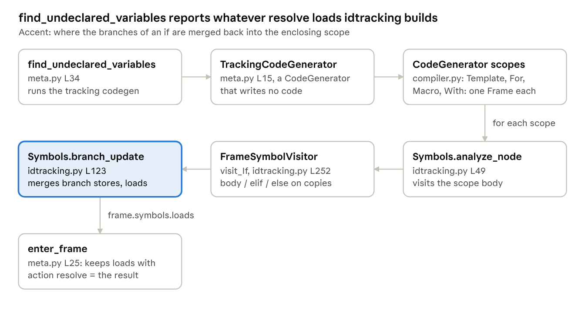

# Homework 3 Reflection Report: Fixing Jinja #2069 with a Coding Agent

Rachit · CS593 ASE · Repository: `<your-repo-url>` · Branch: `hw3-fix-2069` (from tag `3.1.6`)

**Coding agent:** Claude Code (Claude Opus 5.5), VS Code extension, with the graphify skill for building a repository knowledge graph.

---

## 1. Repository Understanding and Bug Reproduction

### 1.1 The bug

[Issue #2069](https://github.com/pallets/jinja/issues/2069) reports that `jinja2.meta.find_undeclared_variables()` lists a variable as undeclared even though the template assigns it in every branch of an `if` statement:

```jinja



{{ output }}
```

| | Result |
| --- | --- |
| Expected | `{'control'}` |
| Observed (3.1.5, 3.1.6) | `{'control', 'output'}` |

The function's job is to list the variables a caller must supply in the render context. Here `output` is set on every path before it is printed, so it never comes from the context. Reporting it is a false positive.

**Confirming the expected answer.** The issue states the expected value but does not justify it, so the agent checked it by rendering the template with a decoy `output='FROM_CONTEXT'` in the context. For `control` = 1, 2, 3 and 99 the output was `1`, `2`, `3` and `3`, so the decoy was never used. Removing the `else` changes this: `{{ y }}` renders `FROM_CONTEXT` when `x` is false. In that template `y` genuinely is undeclared and must still be reported.

**When it happens.** The issue title blames 3.1.5, but a commenter on the issue reported that `if/else` also fails on 3.1.4. The agent ran the same templates against 3.1.4, 3.1.5 and 3.1.6 (`report/scripts/version_matrix.py`):

| Template shape | Expected | 3.1.4 | 3.1.5 and 3.1.6 |
| --- | --- | --- | --- |
| `if / elif / else`, every branch assigns (the issue) | `control` | correct | adds `output` |
| `if / else`, both branches assign | `x` | adds `y` | adds `y` |
| Nested `if / else`, every path assigns | `a, b` | adds `y` | adds `y` |
| Same, inside a `for` loop or a macro | loop var / none | adds `y` | adds `y` |
| `if` with no `else` | `x, y` | correct | correct |
| `if / elif / else` where one branch skips the assignment | `x, y, z` | correct | correct |

The bug occurs whenever a name is assigned on *every* path through an `if` that has an `else`. It is not specific to `elif`, and 3.1.5 did not introduce it: 3.1.5 only broke the `elif` form, which 3.1.4 happened to get right. When some path leaves the name unassigned, reporting it is correct. A fix must keep those rows correct and cannot simply ignore assignments inside conditionals.

### 1.2 Relevant components

`find_undeclared_variables()` doesn't analyze templates itself. It runs Jinja's real code generator in a mode that writes no code and collects every name the generated code would look up from the context.



*Figure 1. Call path from the public function to the code that decides each variable's lookup.*

- **`meta.py`:** `TrackingCodeGenerator` subclasses `CodeGenerator`. Its `enter_frame()` keeps every symbol whose load action is `resolve` (look it up in the context). That set is the function's result.
- **`compiler.py`:** `CodeGenerator` builds a `Frame` for each scope (template body, `for` loop, macro). For the issue's template, the generated code starts with `l_0_output = resolve('output')`, so the context lookup comes from the compiler's own symbol table, not from a separate mistake in `meta.py`.
- **`idtracking.py`:** `FrameSymbolVisitor.visit_If()` analyzes each branch of an `if` separately, then `Symbols.branch_update()` merges the branches back into the enclosing scope and decides each name's load action. This is where Part 2 starts.

**How the agent found these.** It ran `/graphify` to build a knowledge graph of the repository (about 2,800 nodes), then followed the graph's call and inheritance edges from `find_undeclared_variables` to `branch_update`. It then read only those three files. Along the way it found that the clone was on `main` (164 commits past 3.1.6), not on 3.1.6 as I had told it, and moved the work onto a branch created from the `3.1.6` tag.

> **Figure 2 (screenshot to add):** the agent's graph traversal output showing the `meta → compiler → idtracking` chain.

### 1.3 Reproduction tests

Two tests were added to the existing `TestMeta` class in `tests/test_api.py`, which already holds the tests for `find_undeclared_variables`. They use the suite's `env` fixture and follow the existing test's style.

| Test | Template | What it checks | Why it is there |
| --- | --- | --- | --- |
| `test_find_undeclared_variables_set_in_if_elif_else` | `if / elif / else` on `control`, each branch sets `output` | The result is exactly `{'control'}` | The scenario reported in the issue |
| `test_find_undeclared_variables_set_in_if_else` | `if control / else`, both branches set `output` | The result is exactly `{'control'}` | A commenter's variant, which shows the bug is not specific to `elif` and also fails on 3.1.4 |

Both tests assert that the result *equals* `{'control'}`, rather than that `'output'` is merely absent. This makes each test check two things: the variable assigned on every path is not reported, and the variable used in the condition is still reported. A "fix" that hid all variables near an `if` would therefore still fail.

The tests that check variables which *must* still be reported (no `else`, a branch that skips the assignment, nested ifs) are not reproduction tests, because they already pass. They are added in Part 3 as regression guards. Three existing tests in `tests/test_idtracking.py` already check that a variable assigned in an `if` with no `else` is looked up from the context.

### 1.4 How to reproduce

The branch was created from the release tag with `git switch -c hw3-fix-2069 3.1.6`. To reproduce from a fresh clone:

```bash
git clone <your-repo-url> jinja && cd jinja
git switch hw3-fix-2069          # the branch already exists on the remote
python3.12 -m venv .venv
.venv/bin/pip install -r requirements/tests.txt -e .
.venv/bin/python -m pytest tests/test_api.py::TestMeta -v
```

On 3.1.6 with only the tests added, both new tests fail and everything else passes:

```
tests/test_api.py::TestMeta::test_find_undeclared_variables PASSED
tests/test_api.py::TestMeta::test_find_undeclared_variables_set_in_if_elif_else FAILED
tests/test_api.py::TestMeta::test_find_undeclared_variables_set_in_if_else FAILED
tests/test_api.py::TestMeta::test_find_refererenced_templates PASSED
tests/test_api.py::TestMeta::test_find_included_templates PASSED
E       AssertionError: assert {'control', 'output'} == {'control'}
E         Extra items in the left set:
E         'output'
```

Full suite: **2 failed, 909 passed**. Before the tests were added, the suite was 909 passed.

> **Figure 3 (screenshot to add):** the failing pytest run above.

---

## 2. Bug Localization and Root Cause Analysis

*To be completed in Part 2.*

- Root cause and the relevant source code
- How the agent investigated and reached its diagnosis
- Incorrect assumptions, irrelevant code explored, or guidance needed

## 3. Patch Implementation and Validation

*To be completed in Part 3.*

- Summary of the patch and why it fixes the bug
- How the agent generated and refined the patch
- Test results before and after: reproduction tests, additional tests, regression suite
- Remaining limitations

## 4. Reflection on Coding Agent Performance

*To be completed in Part 4. Observations so far:*

- **Checked claims against execution.** It caught that the clone was not on 3.1.6, although my prompt said it was. It also found that the bug predates 3.1.5, contrary to the issue's title.
- **Used tools that partly failed.** `graphify query` crashed (a missing `anyio` package) and the GitHub CLI was not installed. The agent fell back to reading the graph file directly and fetching the issue page through a subagent.
- **Spent extra effort that didn't help.** It built the graph before checking the version, so the graph had to be rebuilt. Its analysis of the documentation cost about 365k tokens and added little to finding this bug.
- **Did not see the issue text verbatim.** The page fetch returned a summary, so the first test's template is reconstructed from it rather than copied from the issue.
